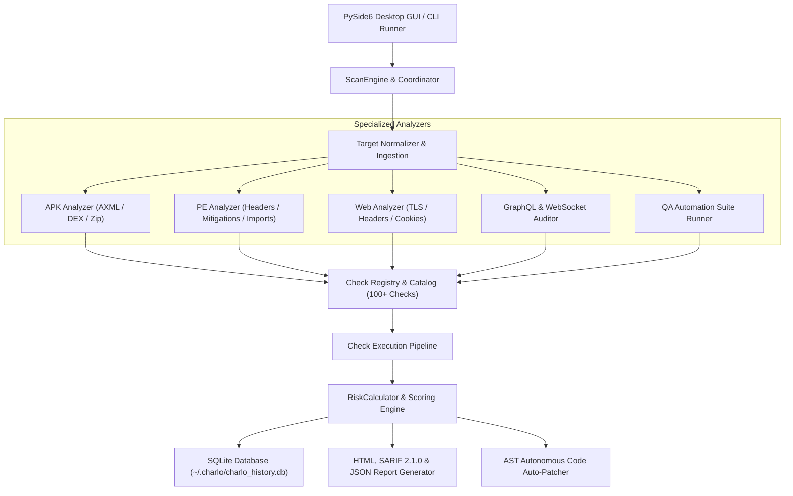

# CHARLO Testing Agent
## Autonomous AI-Powered Security, QA & Automated Remediation Workstation

<p align="center">
  <a href="https://cbagh0819-ctrl.github.io/charlo-testing-agent/">
    
  </a>
</p>

<p align="center">
  <a href="https://cbagh0819-ctrl.github.io/charlo-testing-agent/"></a>
  <a href="https://cbagh0819-ctrl.github.io/charlo-testing-agent/"></a>
  <a href="https://cbagh0819-ctrl.github.io/charlo-testing-agent/"></a>
  <a href="https://cbagh0819-ctrl.github.io/charlo-testing-agent/"></a>
  <a href="LICENSE"></a>
</p>

> ### 🌐 Official Live Product Website
> 👉 **[https://cbagh0819-ctrl.github.io/charlo-testing-agent/](https://cbagh0819-ctrl.github.io/charlo-testing-agent/)**  
> Experience CHARLO Testing Agent online with an **interactive live PoC exploit runner**, high-resolution workstation tour, filterable 18-engine catalog, and autonomous code auto-patcher diff studio.

---

CHARLO Testing Agent is a professional, authorized cybersecurity analysis workstation for Windows 10/11. It provides multi-target automated security auditing across **Android APK packages**, **Windows PE executables (.exe, .dll)**, and **Web Applications**, backed by an evidence-grounded risk engine, 18 specialized testing engines, AST code auto-patching, and actionable remediation guidance.

---

## 🌐 Live Website & Online Features

Visit **[https://cbagh0819-ctrl.github.io/charlo-testing-agent/](https://cbagh0819-ctrl.github.io/charlo-testing-agent/)** to explore:

1. **⚡ Interactive Live PoC Exploit & Sandbox Runner**:
   - Dispatch non-destructive probes (SQLi, XSS, CSWSH, Path Traversal, CORS wildcard) against custom target URLs.
   - Inspect live telemetry logs, response headers, and AST remediation guidance directly in your browser.
2. **🖥️ High-Resolution Workstation Tour & Lightbox**:
   - Interactive carousel covering all 7 UI screens (Homepage, Technical Findings & SARIF, Bug Finder & Leaks, QA Test Automation, PoC Sandbox Dialog, AutoPatch Studio, Webhook Watchdog).
   - Click to zoom full-resolution modal screenshots.
3. **⚙️ 18 Specialized Engines Catalog with Instant Filter & Search**:
   - Filter by domain: Binary & Mobile, Web & APIs, QA & Performance, DevSecOps & CI, Remediation & System.
   - Live search by check name, standards (OWASP, NIST, CWE), or output formats.
4. **✨ Autonomous Code Auto-Patcher & Unified Git Diff Studio**:
   - Switch between real-world flaw remediation diffs (SQLi, Stored XSS, Hardcoded Secrets, Missing CSRF Guard, Insecure Cookie Flags, Path Traversal).
   - One-click **Copy Diff** and dynamic **Download `.patch`** generation.
5. **📊 Feature Comparison Benchmark**:
   - Side-by-side matrix comparing CHARLO with OWASP ZAP, SonarQube Developer, and Snyk Free.
6. **❓ Interactive Knowledge Base & FAQ Accordion**:
   - Common answers regarding 100% offline privacy, AST safety with `.bak` backups, and CI/CD integration.

---

## 🌟 Key Capabilities

- **Android APK Security Analysis**: Pure-Python manifest parsing (AXML binary string pool decoding), permission auditing against least-privilege principles, exported components boundary checks, DEX bytecode string extraction for hardcoded secrets, certificate verification, and cryptographic weakness auditing (DES/ECB).
- **Windows EXE PE Analysis**: High-performance PE header and section parsing (`pefile`), exploit mitigation verification (ASLR, DEP/NX, Control Flow Guard, SafeSEH), Authenticode digital signature directory checking, W^X (Writable and Executable) memory section violation detection, section Shannon entropy calculation for packers/obfuscation, and suspicious API import analysis (process injection, memory writing, debugger evasion).
- **Website & Web Application Auditing**: Safe, non-destructive transport and security header auditing (HTTPS enforcement, HSTS, CSP with unsafe-inline/eval detection, X-Frame-Options clickjacking defense, X-Content-Type-Options nosniff, Referrer-Policy), cookie flag verification (Secure, HttpOnly, SameSite), CORS configuration auditing, and sensitive route disclosure analysis via `robots.txt`.
- **100-Check Security Catalog**: Structured across Basic, Intermediate, and Advanced tiers, mapped directly to industry standards (**OWASP Mobile Top 10**, **OWASP Web Top 10**, **CWE**, **NIST SP 800-53**, **MASVS**).
- **Autonomous Code Auto-Patcher**: AST and regex code remediation engine generating Unified Git Diffs (`.patch`). Safely transforms vulnerable code with automatic `.bak` backup and one-click rollback.
- **Universal OASIS SARIF 2.1.0 Exporter**: Emits standard SARIF reports ready for GitHub Code Scanning alerts, GitLab Security Dashboards, Azure DevOps, and SonarQube.
- **Full-Stack QA Automation Workbench**: Evaluates and runs automated test suites across Playwright, Selenium, Appium (Android), and WinAppDriver (Windows Desktop), diagnosing flaky risks.
- **Evidence-Grounded Risk Scoring**: Deterministic score (0-100) and posture grade (`A+`, `A`, `B`, `C`, `D`, `F`), capping scores when critical vulnerabilities are discovered.
- **Actionable Remediation Center**: Every finding includes affected component, raw evidence snippet, why the issue matters (impact), step-by-step developer remediation, and secure code/configuration diffs.
- **Dual Mode (GUI & CLI)**: Modern Cyberpunk/Workstation PySide6 (Qt) desktop application with drag-and-drop file ingestion, live progress bars, real-time log terminal, plus headless CLI mode for CI/CD pipelines.
- **Cyber Crimson & Obsidian Workstation UI**: Sleek, modern 3-column AI cybersecurity laboratory interface featuring interactive target selection cards, floating pill navigation, real-time Security Pulse concentric radar, live telemetry counters, and dark gradient cards.
- **Test a Hack (Theoretical Attack Resilience Simulator)**: Evaluates target survivability against 11 real-world attack vectors (SQLi, DDoS, BOLA/IDOR, XSS, Buffer Overflow, DLL Side-Loading, Pass-the-Hash/Kerberoasting, Ransomware, SSRF, Credential Stuffing, Mobile Intent Hijacking), computing exact statistical survival rates and hardening roadmaps without running real offensive payloads.
- **Reporting & Persistence**: Standalone, interactive HTML audit reports, structured JSON export, and local SQLite audit history database.
- **Dedicated Bug Finder Engine**: Specialized software defect scanner detecting memory/handle leaks, broken links, form input validation flaws, stack trace leaks, and crash hazards across APKs, EXEs, and Web targets.
- **Domain Chronology & Admin Intelligence**: Complete historical intelligence engine evaluating domain purchase/expiration dates, domain age, registrar details, website evolutionary changes (Wayback Machine CDX API), administrator technical maturity profiling (0-100 score), historical security incident/defacement checks, and total site storage footprint estimation (MB/GB).

---

## 🌐 Website History & Admin Intelligence Inspector

| Capability | What It Analyzes |
|---|---|
| **Domain Registration & Expiration** | Standardized ICANN/IETF RDAP protocol lookup: Domain Registration date, Expiration date, Days to expiration, Age in years/months, Registrar (e.g. ERNET, GoDaddy, Cloudflare), and DNSSEC cryptographic status. |
| **Site Type & Evolution** | Classifies target into Academic Institution, E-Commerce Store, CMS Blog (WordPress), Government Portal, or Modern Cloud SaaS SPA. |
| **Admin Technical Maturity Profile** | Heuristic evaluation of admin behavior, security awareness (0-100% score), tier assignment (Novice, Intermediate, Hardened DevSecOps), technical strengths, and configuration blind spots. |
| **Year-by-Year Upgrades Timeline** | Synthesizes historical evolution from Internet Archive Wayback snapshots, tracking yearly architecture changes, HTTPS migrations, and feature deployments. |
| **Historical Security & Incident Audit** | Scans for defacement signatures (`hacked by`, web shell trails, backdoor keywords), historical instability patterns, and past deployment leakages (`.git`, `.env`). |
| **Site Data Footprint (Storage Weight)** | Samples homepage HTML and linked assets (scripts, stylesheets, images) to estimate total storage weight (e.g., Lightweight ~15-60MB vs Large Institutional Archive ~350MB-1.8GB). |

---

## 🐞 Dedicated Bug Finder Engine

CHARLO includes a dedicated **Bug Finder Laboratory** capable of hunting down implementation defects and software bugs:

| Target Category | Bug Checks Included | Defect Types Detected |
|---|---|---|
| **Web Applications** | `BUG-WEB-001` to `BUG-WEB-006` | Broken links (404/500/dead ends), Form & CSRF flaws, Unconstrained input lengths, Stack trace leaks (Python, PHP, Java, ASP.NET, Node.js), Empty asset sources, Missing alt tags, Missing viewport, Insecure mixed content |
| **Windows Executables** | `BUG-EXE-001` to `BUG-EXE-005` | Memory & Handle resource leaks (CreateFile without CloseHandle, HeapAlloc without HeapFree), Banned CRT functions (strcpy, strcat, sprintf, gets, scanf), Unquoted service paths with spaces, Missing /GS Security Cookies & SafeSEH, Missing Common Controls v6 & DPI awareness |
| **Android Applications** | `BUG-APK-001` to `BUG-APK-005` | Synchronous network calls on main UI thread (ANR hazard), SQLite Cursor memory leaks (missing cursor.close()), Fragile dynamic reflection (Class.forName/DexClassLoader), Android 12+ missing android:exported manifest crash, Deprecated fragment lifecycle state loss |

---

## 🏗️ Architecture



---

## 🚀 Quick Start (Windows)

### 1-Click Launch (Recommended for Windows)
Double-click `Launch_CHARLO.bat` in the repository root or run:
```powershell
.\Launch_CHARLO.bat
```
This automatically initializes an isolated Python virtual environment, installs dependencies, and launches the PySide6 workstation with hardware acceleration.

### Manual Setup via PowerShell / Bash
```powershell
# Clone the repository
git clone https://github.com/cbagh0819-ctrl/charlo-testing-agent.git
cd charlo-testing-agent

# Install dependencies
python -m pip install -r requirements.txt

# Launch GUI Workstation
python main.py

# Run Automated Test Suite (133 verification tests)
python -m pytest tests -v
```

### Headless CLI CI/CD Integration
```powershell
# Full Web & GraphQL Audit with SARIF export for GitHub Code Scanning
python main.py --cli --target "https://api.example.com" --level advanced --sarif audit.sarif --graphql

# Scan an Android Application (.apk)
python main.py --cli --target "sample.apk" --level intermediate --html apk_audit.html

# Scan Windows PE Executable with Webhook Notification
python main.py --cli --target "C:\Windows\System32\notepad.exe" --bugs --webhook "https://hooks.slack.com/services/..."
```

---

## 📦 Building Standalone Windows Executable & Installer

### 1. Build Standalone Native Windows EXE (`PyInstaller`)
```powershell
python -m pip install pyinstaller
pyinstaller pyinstaller.spec --clean -y
```
The compiled binary package will be generated inside `dist\CharloTestingAgent\CharloTestingAgent.exe`.

### 2. Compile Windows Installer (`Inno Setup`)
Download and install Inno Setup 6, then compile `installer.iss`:
```powershell
& "C:\Program Files (x86)\Inno Setup 6\ISCC.exe" installer.iss
```
The resulting installer `CharloTestingAgent_Setup_v1.0.0.exe` will be located in `dist_installer\`.

---

## 📄 License & Attribution
- Author: [cbagh0819-ctrl](https://github.com/cbagh0819-ctrl)
- Licensed under the [MIT License](LICENSE).
- Official Website: [https://cbagh0819-ctrl.github.io/charlo-testing-agent/](https://cbagh0819-ctrl.github.io/charlo-testing-agent/)


## WORKING PICS


